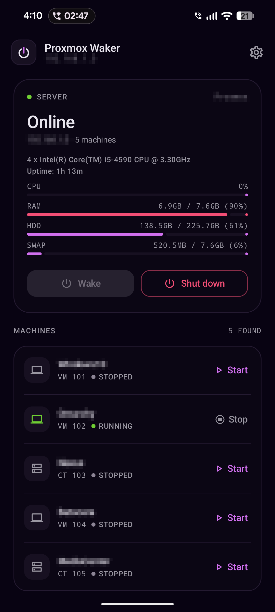
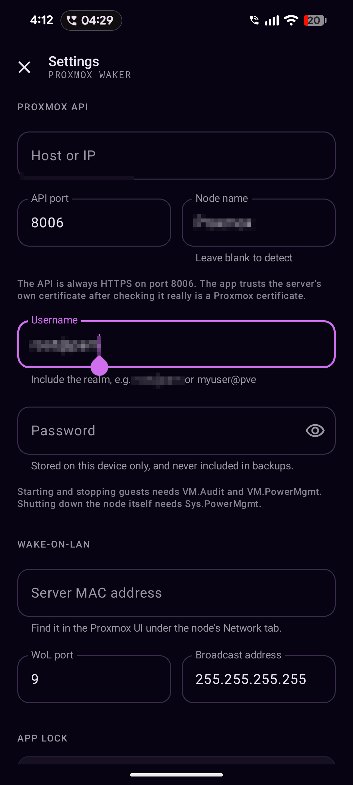

# Proxmox Waker

[](https://github.com/sndpsdhsvm/proxmox-waker/actions/workflows/ci.yml)
[](https://github.com/sndpsdhsvm/proxmox-waker/releases/latest)
[](LICENSE)

> **Unofficial project.** Not affiliated with, endorsed by, or supported by
> Proxmox Server Solutions GmbH. "Proxmox" is a trademark of Proxmox Server
> Solutions GmbH. See [License](#license).

An Android app that turns your Proxmox server on and off over your LAN, then lets
you manage its virtual machines from the phone.

Three jobs, one screen:

1. **Wake the server** — sends a Wake-on-LAN magic packet to the machine's NIC.
2. **Manage guests** — lists your VMs and containers, each with Start or Stop.
3. **Shut down the node** — sends a graceful ACPI shutdown to the Proxmox host
   itself, with a confirmation first.

No cloud service, no account, no telemetry. The app talks straight to your Proxmox
host on your local network.

---

## What it looks like

<p align="center">
  
  
</p>

- **Node panel** — one calm card for the host. An animated power core shows
  online/offline state, alongside the node name and the two power actions: **Wake**
  and **Shut down**. Shutdown asks for confirmation and then watches the API until
  the node stops answering.
- **Machine list** — every QEMU VM and LXC container on the node in a single
  uncluttered list, with a status dot and Start or Stop. Running machines offer
  **Stop** (a graceful ACPI shutdown). The ⋮ menu adds **Reboot**, **Force stop**,
  and, for VMs, **Reset**; the destructive actions confirm first.
- **Settings** — host, port, node name, credentials, the wake-on-LAN details, and
  the fingerprint lock. **Test** checks without saving; **Save and connect**
  applies and returns to the main screen, and the system back button does the
  same. Opens automatically on first launch.
- **Fingerprint lock** — the controls are hidden behind the phone's fingerprint
  prompt on a fresh start, including after the app is killed from recents.
  Switching away and coming back does not re-prompt. It is on by default because
  the app can power the whole node; turn it off in Settings if you prefer. A
  device with no enrolled fingerprint is not locked out.

The list refreshes quietly every 3 seconds while the app is on screen, and
immediately whenever you return to it. Reads happen in place: no spinner, no
layout jump, no label counting down — the rows just settle onto their new values
and a small footer shows whether the app is live, reconnecting, or offline. Nothing
is cached to disk.
Pull down anywhere on the list for a manual refresh — including while the node is
offline, as long as the phone has Wi-Fi, Ethernet, or a VPN. The gesture is
disabled when there is no network at all. The refresh puck fills as you drag,
ticks the haptic at the trigger point, and spins with the theme accent gradient
while the API call is in flight. A
successful wake ends with a small confetti burst. Motion carries the interface: the node card,
machine list, and footer assemble with a soft stagger, counters and resource bars
ease to their new values, and each row's Start/Stop control crossfades in place.
Settings slides over the main screen, shimmering skeleton rows hold the list while
the first read lands, and splash, lock, and main crossfade into one another. The
visual language follows Omarchy: near-black plum, warm off-white text, a violet
accent, and a quieter, type-led layout with a slow aurora glow behind it.

---

## Install

Download the latest signed APK from the [Releases page](../../releases/latest) and
open it on your phone. Android 8.0 (API 26) or newer is required.

To build it yourself, see [Building](#building).

---

## Before you build: two things to set up on the server

### 1. Enable Wake-on-LAN on the Proxmox host

On the Proxmox server, check that the NIC supports and has WoL enabled:

```bash
ethtool eth0 | grep -i wake
```

Look for `Wake-on: g` (magic packet). If it says `d`, enable it:

```bash
ethtool -s eth0 wol g
```

To make it survive reboots, add it to `/etc/network/interfaces` under the interface
stanza:

```
post-up /usr/sbin/ethtool -s eth0 wol g
```

Also enable "Wake on LAN" / "Power On By PCI-E" in the motherboard BIOS. WoL only
works from a *powered-off but plugged-in* state (or S3 suspend) — not after pulling
the plug.

Note the NIC's MAC address; `ip link show eth0` prints it. You need it for the app.

> **If WoL doesn't reach the server:** some routers and switches drop broadcast
> packets, and a sleeping machine obviously can't receive anything over IP. If your
> setup gives you trouble, enable "Directed Broadcast" / a static ARP entry on the
> router, or run a tiny always-on device (a Raspberry Pi, another Proxmox node) that
> can send the packet. The app's broadcast address field exists for exactly this.

### 2. Decide which Proxmox user the app logs in with

You chose username/password login, so the app authenticates as a normal Proxmox
user. Using the built-in root account works, but it is a lot of power to hand a
phone app.

A dedicated user is safer. In the Proxmox UI: **Datacenter → Permissions → Users →
Add**, then **Permissions → Add → User Permission**:

- Path: `/vms/<vmid>` (or `/vms` for all guests)
- User: your new user
- Role: **PVEVMUser** covers start/stop and read access

For guest power actions, `PVEVMUser` on `/vms` is enough. **Node shutdown is
different:** the built-in `PVEAdmin` role deliberately excludes `Sys.PowerMgmt`, so
create a small custom role and grant it on the node:

```bash
pveum role add Sys_Power-only --privs "Sys.PowerMgmt"
pveum acl modify /vms -user waker@pve -role PVEVMUser
pveum acl modify /nodes/<node> -user waker@pve -role Sys_Power-only
```

You do **not** need `PVEAdmin` or `root`. The app only calls:

| Call | Purpose |
| --- | --- |
| `POST /access/ticket` | log in |
| `GET /nodes` | connection test + node discovery |
| `GET /version` | version string |
| `GET /nodes/<node>/qemu`, `/lxc` | list guests |
| `POST /nodes/<node>/{qemu,lxc}/<vmid>/status/start` | start |
| `POST /nodes/<node>/{qemu,lxc}/<vmid>/status/shutdown` | stop |
| `POST /nodes/<node>/status` (`command=shutdown`) | shut down the node |

---

## Building

Requirements:

- **JDK 17** (Temurin, OpenJDK, or the JDK bundled with Android Studio)
- **Android SDK** with platform 35 and build-tools 34.0.0 / 35.0.0
- `ANDROID_HOME` pointing at the SDK, or a `local.properties` file containing
  `sdk.dir=/path/to/Android/Sdk`

The Gradle wrapper downloads Gradle 8.11.1 on first use.

```bash
./gradlew assembleDebug
```

The debug APK lands at `app/build/outputs/apk/debug/app-debug.apk`. Run the unit
tests and lint with:

```bash
./gradlew testDebugUnitTest lintDebug
```

`./build.sh` is a convenience wrapper used on the author's machine. It looks for
JDK 17 through [mise](https://mise.jdx.dev/) and the SDK in `~/Android/Sdk`; you do
not need it if those tools are already on your `PATH`.

### Release builds

Release builds are minified with R8. They are signed only when these environment
variables are set:

| Variable | Value |
| --- | --- |
| `RELEASE_STORE_FILE` | absolute path to the `.jks` / `.keystore` file |
| `RELEASE_STORE_PASSWORD` | keystore password |
| `RELEASE_KEY_ALIAS` | key alias |
| `RELEASE_KEY_PASSWORD` | key password |

Create a keystore once and keep it somewhere safe (never commit it):

```bash
keytool -genkeypair -v -keystore release.keystore -alias proxmox-waker \
  -keyalg RSA -keysize 4096 -validity 10000
```

Then:

```bash
RELEASE_STORE_FILE="$PWD/release.keystore" \
RELEASE_STORE_PASSWORD=... \
RELEASE_KEY_ALIAS=proxmox-waker \
RELEASE_KEY_PASSWORD=... \
./gradlew assembleRelease
```

The signed APK lands at `app/build/outputs/apk/release/app-release.apk`. Without
the variables, Gradle produces an unsigned APK that cannot be installed.

For the automated GitHub Release workflow, add these repository secrets:

| Secret | Value |
| --- | --- |
| `KEYSTORE_BASE64` | `base64 -w0 release.keystore` |
| `KEYSTORE_PASSWORD` | keystore password |
| `KEY_ALIAS` | key alias |
| `KEY_PASSWORD` | key password |

Pushing a tag such as `v1.0.0` runs the `Release` workflow, which builds and
attaches `ProxmoxWaker-v1.0.0.apk` plus `SHA256SUMS`.

### Installing it on your phone

Download the APK from the Releases page, or install a local build with:

```bash
adb install -r app/build/outputs/apk/debug/app-debug.apk
```

Enable **Developer options → USB debugging** on the phone first. `./install.sh`
is a convenience wrapper that builds, installs, and launches the debug APK. If you
copy the APK to the phone instead, allow installing from unknown sources.

---

## First run

The settings screen opens on its own. Fill in:

| Field | Value |
| --- | --- |
| Host or IP | your Proxmox host, e.g. `192.0.2.10` |
| API port | `8006` (default) |
| Node name | the node as shown in the Proxmox UI, e.g. `pve` |
| Username | your dedicated user with its realm, e.g. `waker@pve` |
| Password | that user's password |
| Server MAC address | the NIC's MAC, e.g. `AA:BB:CC:DD:EE:FF` |
| WoL port | `9` (default) |
| Broadcast address | `255.255.255.255` (default) |

Tap **Test** to check the connection without saving anything, or **Save and
connect** to store it and load your machines right away.

A few notes:

- The **node name** is optional. Leave it blank and the app discovers it by listing
  the cluster's nodes, then remembers it. If you do enter a name that doesn't exist,
  the error lists the real node names so you can correct it. (The old default of
  `pve` was a common trip-up on hosts named anything else.)
- **HTTPS is not optional.** Proxmox serves the API over TLS on 8006 and answers
  cleartext requests with a `301` redirect, so the app always uses `https://`.
  See the certificate note below.
- **Turn Wi-Fi off and nothing works.** Wake-on-LAN is a broadcast, and the Proxmox
  API is on your LAN. There's no remote access story here by design.

Finding the MAC address: in the Proxmox UI, select the node → **System → Network**,
or over SSH:

```bash
ip link show | grep -A1 "state UP"
```

### Usage flow

1. Server is asleep. Open the app, tap **Wake**.
2. The node panel shows "Waking up", and the app polls the API.
3. When Proxmox finishes booting, the panel reads "Online" and your VMs appear.
4. Tap **Start** next to the machine you want. The list updates a couple of seconds
   later to show it running.
5. To power the host down, tap **Shut down**, confirm, and the app watches the API
   until the node goes offline. Wake-on-LAN can bring it back later.

If the server is already on, skip the wake step — the app refreshes on resume, every
3 seconds while visible, and whenever you pull down on the list.

## Limitations

- **TFA / 2FA is not supported.** When a Proxmox account has TFA enabled, the
  ticket login needs a second `tfa-challenge` request. The app does not implement
  that step yet, so those logins fail. Use a dedicated account without TFA until
  support lands.
- **One node at a time.** Clusters are not modelled; the app talks to a single
  Proxmox node.
- **LAN only.** There is no cloud relay, VPN handling, or remote-access mode.
- **Credentials are not hardware-backed encrypted.** They live in app-private
  storage, excluded from backups and device transfer. See
  [SECURITY.md](SECURITY.md) for the full threat model.

---

## Project layout

```
app/src/main/java/dev/sndp/proxmoxwaker/
├── MainActivity.kt              Compose host, fingerprint prompt, app stage transitions
├── data/
│   ├── ProxmoxConfig.kt         Config + Guest/GuestType/GuestStatus models
│   └── SettingsRepository.kt    DataStore persistence
├── net/
│   ├── ProxmoxClient.kt         Ticket auth + API calls (OkHttp)
│   ├── TlsSupport.kt            Accepts Proxmox's per-install self-signed CA
│   ├── WakeOnLan.kt             Magic packet build + send
│   └── NetworkUtils.kt          Local IPv4 discovery
├── security/
│   └── BiometricAuth.kt         Fingerprint availability check + system prompt
└── ui/
    ├── MainViewModel.kt         State machine: wake → wait → list → start/shutdown
    ├── MainScreen.kt            Node panel, guest list, pull-to-refresh, dialogs
    ├── GuestSheet.kt            Per-guest action sheet (reboot, force stop, reset)
    ├── Effects.kt               Aurora, confetti, power core, shimmer, entrances
    ├── LockScreen.kt            Fingerprint gate shown while locked
    ├── SettingsScreen.kt        Config editor + app-lock toggle
    └── Theme.kt                 Omarchy-inspired Material 3 theme
```

Tests (`app/src/test/java/…`):

- `WakeOnLanTest.kt` — MAC parsing in four formats, magic-packet byte layout, UDP send.
- `ProxmoxContractTest.kt` — pins the documented API response shapes, string
  constants and status mapping, so a regression in the client's assumptions is
  caught without a server.
- `ProxmoxClientTest.kt` — verifies the node shutdown endpoint and form body.

---

## Hardening the TLS setup (optional)

The app accepts the server's self-signed certificate because that is the only way
a stock Proxmox install can work. If you would rather have real verification, you
need the certificate to be trustworthy *and* the phone to know the CA:

1. Install your Proxmox CA (`/etc/pve/pve-root-ca.pem`, or
   `/etc/pve/local/pve-ssl.pem`'s issuer) on the phone as a user certificate.
   Android's **Settings → Security → Encryption & credentials → Install a
   certificate** does this.
2. Or replace the certificate entirely with one from a public CA by pointing
   Proxmox at it (`pvenode cert set ...`).

Either way the system trust store validates the connection and the app's fallback
path is never used. The fingerprint shown in Settings is your reference for what it
accepted.

---

## How the Proxmox API works (and what this app assumes)

Everything below was verified against a live Proxmox VE host and cross-checked
with the official documentation, because the first version of
this app got several of these wrong and failed on all of them at once.

**Sources:** [Proxmox VE API wiki](https://pve.proxmox.com/wiki/Proxmox_VE_API)
and the generated `apidoc.js` schema behind the
[API viewer](https://pve.proxmox.com/pve-docs/api-viewer/index.html).

### 1. The certificate is self-signed by a per-install CA

```
subject = OU=PVE Cluster Node, O=Proxmox Virtual Environment, CN=Proxmox.local
issuer  = CN=Proxmox Virtual Environment, OU=9e2351b9-...-ada22410ed8f,
          O=PVE Cluster Manager CA
Verify return code: 21 (unable to verify the first certificate)
```

That CA is generated when Proxmox is installed and exists only on your server. No
phone will ever trust it. A stock HTTPS client fails the handshake:

```
$ curl https://192.0.2.10:8006/api2/json/version
curl: (60) SSL certificate OpenSSL verify result: unable to get local issuer
certificate (20)
```

**This was why the app appeared to do nothing.** `TlsSupport.kt` now handles it:

1. The system trust store is tried first, so a proper certificate (e.g. Let's
   Encrypt) validates normally.
2. A rejected certificate is accepted **only** if it identifies itself as a Proxmox
   certificate *and* covers the host being contacted (SAN or CN) *and* is within its
   validity window. This mirrors what `pve-apiclient` and `proxmoxer` do.
3. The accepted SHA-256 fingerprint is stored and shown in Settings, so an
   unexpected certificate change is visible rather than silent.

It is deliberately not a blanket "trust all" manager: a certificate that doesn't
look like Proxmox, or that doesn't cover the host, is still rejected.

### 2. Authentication is a ticket in a cookie

```
POST /access/ticket   username=waker@pve&password=...    (form-encoded)
  → 200 {"data":{"ticket":"PVE:waker@pve:...",
                 "CSRFPreventionToken":"...",
                 "username":"waker@pve"}}

GET  /nodes           Cookie: PVEAuthCookie=<ticket>
POST /nodes/pve/qemu/100/status/start
                      Cookie: PVEAuthCookie=<ticket>
                      CSRFPreventionToken: <token>     ← writes only
```

- Bad credentials are **`401`** with `{"message":"authentication failure\n","data":null}`.
- The **`CSRFPreventionToken` header is only required for POST/PUT/DELETE**. Sending
  it on reads is unnecessary.
- Tickets last **2 hours**, so the client caches with an expiry and re-logs-in when
  a call comes back `401`.

### 3. Some obvious-looking choices are wrong

| Assumption | Reality |
| --- | --- |
| `/version` is a public endpoint you can use as a connection test | It is **authenticated** (`401 No ticket`), so it's no cheaper than any other call |
| Plain HTTP on 8006 is a fallback if TLS is awkward | `http://…:8006/...` returns **`301`** to `https://`; TLS is not optional |
| The node is always called `pve` | It is whatever the host was named; the app now discovers it via `GET /nodes` |
| The CSRF token goes on every request | Only on write methods |

The connection test therefore calls `GET /nodes`, which both proves the credentials
and discovers the node name for the guest endpoints.

### Endpoints used

| Call | Purpose |
| --- | --- |
| `POST /access/ticket` | log in |
| `GET /nodes` | connection test + node discovery |
| `GET /version` | version string for the status message |
| `GET /nodes/<node>/qemu`, `/lxc` | list guests |
| `POST /nodes/<node>/{qemu,lxc}/<vmid>/status/start` | start |
| `POST /nodes/<node>/{qemu,lxc}/<vmid>/status/shutdown` | stop |
| `POST /nodes/<node>/status` (`command=shutdown`) | shut down the node |

---

## Security notes

- The password is stored in app-private DataStore and is excluded from Android
  backup and device transfer, so it does not leave the phone. It is **not**
  hardware-backed encrypted — anyone with root on an unlocked phone can read it.
  That is the tradeoff for password login instead of tokens. Use a dedicated
  low-privilege Proxmox user so a leak is contained.
- The app is gated by the phone's fingerprint sensor (androidx.biometric, Class 3
  biometrics) each time it starts. That includes reopening it after it was killed
  from recents; merely switching away and back does not re-prompt. This is a local
  gate: it stops someone who picks up an unlocked phone from opening the app and
  powering the node or its guests. It does **not** replace the Proxmox password,
  and it cannot protect data on a phone that is rooted or has the app's storage
  extracted.
- All traffic to Proxmox goes over HTTPS, and cleartext is explicitly disallowed in
  `network_security_config.xml`.
- Accepting the self-signed certificate is what makes the app work at all. The
  protection it gives you is scoped acceptance plus a recorded fingerprint, not a
  full chain of trust. The fingerprint is **not pinned**: if the certificate
  changes, the app records and shows the new one instead of refusing the
  connection. If you want real verification, install your Proxmox CA (or a proper
  certificate) on the server and the phone; the app will then use the system trust
  store and skip the fallback entirely.
- `android:allowBackup="false"` is set on the application.

See [SECURITY.md](SECURITY.md) for the full threat model and how to report issues.

---

## If something goes wrong

**"TLS problem talking to …"** — the certificate wasn't accepted. It should be, for a
stock Proxmox install; check that the host you typed matches the certificate and that
the server's clock is roughly right. Verify from a computer with:

```bash
curl -v https://192.0.2.10:8006/api2/json/version
```

**"Node \"x\" was not found on this host"** — the error names the real node(s). Clear
the node field to let the app detect it.

**"Cannot connect to …"** — the server isn't up yet or the port is wrong. Confirm
the host is reachable: `ping 192.0.2.10`, then browse to
`https://192.0.2.10:8006` from your phone's browser (expect a certificate warning;
that is the same self-signed cert the app accepts).

**"Login failed"** — the username needs its realm: `waker@pve`, not `waker`. Also
check for a locked account or a pending password-change requirement. If TFA is
enabled on the account, the app cannot complete the second factor yet; see
[Limitations](#limitations).

**"Permission denied (403)"** — the account lacks `VM.Audit` / `VM.PowerMgmt` on
that guest, or `Sys.PowerMgmt` on the node for shutdown. See the permissions section
above.

**"No machines listed"** — the credentials work (otherwise you'd get a login error),
so the node is probably wrong. The app now detects the node itself; if you typed one
and it was wrong, the error will say so and list the valid names.

**Waking does nothing** — the packet left your phone but nobody acted on it. Check
BIOS WoL, `ethtool`, and whether the machine is truly in a WoL-capable sleep state.
Try the subnet-directed broadcast (e.g. `192.0.2.255`) instead of
`255.255.255.255`, which the app also tries automatically.

**"The server did not come up within 5 minutes"** — it's slower than the timeout, or
it never actually woke. The banner shows the last error the app saw, which tells
you whether it was timing out (never woke) or refused (woke, services not ready).

---

## Ideas for later

Things deliberately left out that would fit naturally:

- A home-screen widget with one button for a specific VM.
- Proxmox API tokens instead of a password (safer, but a bit more setup).
- TFA challenge support so accounts with 2FA can log in.
- Encrypting credentials with the Android Keystore.
- Pinning the accepted TLS certificate, with a "forget certificate" recovery path.
- Remembering a per-VM "favourite" that the wake flow starts automatically.
- A scheduled "shut down after idle" option for the whole node.
- Multi-node / cluster support.

---

## Contributing

See [CONTRIBUTING.md](CONTRIBUTING.md). Bug reports and pull requests are welcome.

## License

[MIT](LICENSE) © 2026 Sandeep Sadhasivam.

This is an unofficial project. "Proxmox" and "Proxmox VE" are trademarks of
Proxmox Server Solutions GmbH. The app is not affiliated with or endorsed by
Proxmox Server Solutions GmbH.
